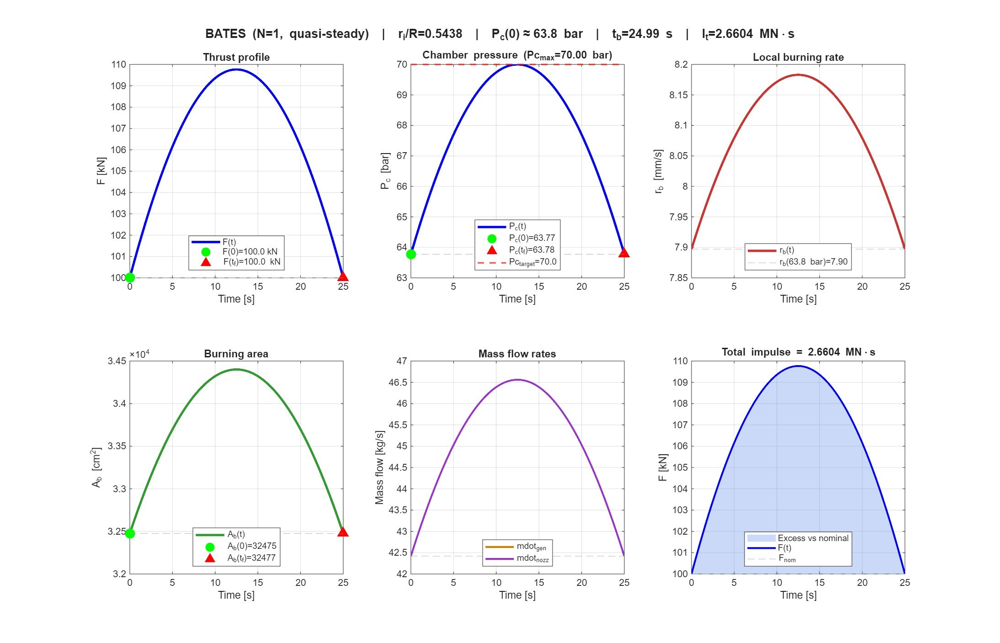
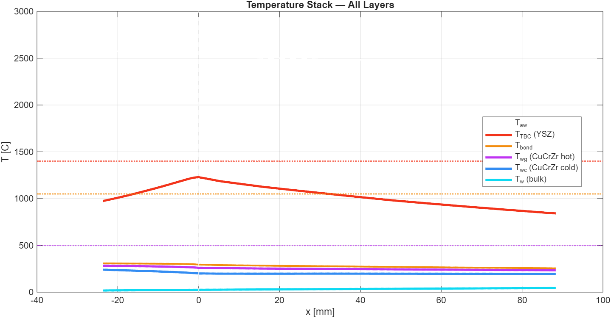
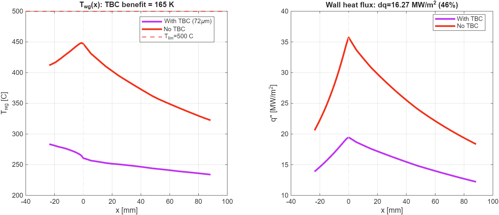
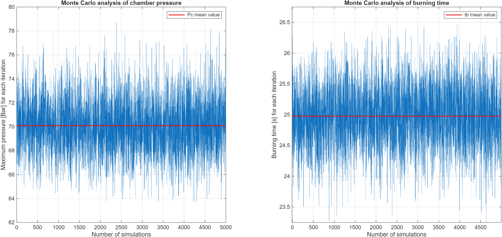

# Solid Rocket Motor Design with a Water-Cooled Nozzle Throat (MATLAB)

Preliminary design of **Stark-100k**, a 100 kN solid rocket motor built as a ground test bed to measure heat loads at the nozzle throat. The design work is done in MATLAB and covers:

- internal ballistics and grain design;
- nozzle sizing;
- the water-cooled throat jacket and its thermal barrier coating;
- the external water feed system;
- a Monte Carlo uncertainty analysis.

Group project ("I Maggici") for the *Space Propulsion* course, MSc in Space Engineering, Politecnico di Milano, A.Y. 2025/26.

## Requirements of the assignment

- Sea-level thrust **100 kN** and total impulse **2.5 MN·s**.
- Non-aluminised **AP/HTPB** composite propellant and a quasi-neutral **BATES** grain.
- Maximum chamber pressure **70 bar**.
- **No refractory throat insert.** The throat region is instead a water-cooled, instrumented jacket, optionally with a thermal barrier coating (TBC) on the hot-gas side.

## Approach

1. **Motor sizing** (`motor_sizing/`)
   - Fits Vieille's burning-rate law to experimental data and takes the thermochemistry from NASA CEA.
   - Sizes the nozzle including divergence and friction losses.
   - Sizes the BATES grain with nested bisection loops on the initial chamber pressure, web thickness and ri/R.
   - Integrates the firing in time with a quasi-steady chamber model, then sizes the chamber insulation and the nozzle ablative protection.
2. **Thermal sizing** (`thermal_sizing/`)
   - Sizes the YSZ thermal barrier coating needed to keep the copper-alloy (CuCrZr) wall and the bond coat within their temperature limits.
   - Searches over channel height, width, number of channels and coolant flow rate for the cooling-channel geometry with the lowest pressure drop that still avoids boiling.
3. **Thermal analysis** (`thermal_analysis/`)
   - Verifies the final design with a 1-D axial marching solver. Hot-gas heat transfer uses the Bartz correlation, coolant heat transfer uses Gnielinski with fin efficiency, gas radiation is included, and water properties come from the IAPWS-IF97 standard.
   - Checks cavitation, onset of nucleate boiling, critical heat flux and Von Mises stress along the jacket.
   - Sizes the nitrogen-pressurised water feed system, and sweeps TBC thickness, coolant flow rate and number of channels.
4. **Uncertainty analysis** (`uncertainty_analysis/`)
   - Monte Carlo simulation with 5000 runs on the ballistic model.
   - Varies the burning-rate coefficients a and n (correlated), the propellant density, the grain length and the throat diameter.

Each folder has its own README with run instructions and a description of the code.

## Main results

**Motor**

| Initial thrust | Max chamber pressure | Burn time | Effective Isp | Total impulse |
|---|---|---|---|---|
| 100 kN | 70 bar | 25.0 s | 240.4 s | 2.66 MN·s |

The total impulse is 6.4 % above the requirement because thrust rises in mid-burn, as it typically does in a quasi-neutral BATES grain. Vieille's law fit: r_b = 1.618 p^0.382 (r_b in mm/s, p in bar), with R² = 0.988.



**Cooling jacket** (90 channels, water at 7.6 kg/s, 72 µm YSZ coating on a CuCrZr liner)

- **Heat flux:** the peak wall heat flux is 19.5 MW/m² at the throat, and the coating reduces it by 46 %.
- **The coating is necessary.** Without it the wall reaches about 445 °C, against the CuCrZr limit of 500 °C. With it the wall peaks at 261 °C, the coating at 1229 °C (limit 1400 °C) and the bond coat at 295 °C (limit 1050 °C).
- **All safety checks pass:**
  - cavitation;
  - onset of boiling, the tightest check, with +11 K of subcooling margin;
  - critical heat flux, safety factor 1.9 against 1.5 required;
  - mechanical stress, margin 1.38.
- **Feed system:** the water tank is pressurised to 52 bar by a 97 L nitrogen bottle (adiabatic blow-down model).





**Uncertainty:** the maximum chamber pressure can reach about 79 bar (+12 % over nominal), and the burn time ranges from 23 to 27 s. The relative standard deviations are 3.2 % on peak pressure and 2 % on burn time.



## Report

- [Project report](solid-rocket-motor-design/report/Stark-100k_report.pdf): full methodology, design choices and discussion.
- [Erratum](solid-rocket-motor-design/report/Stark-100k_erratum.pdf): corrects the nozzle throat area used in the thermal analysis (63.77 bar instead of an outdated 67 bar). It updates the cooling-system results: coating 72 µm instead of 77 µm, coolant 7.6 kg/s instead of 7.9 kg/s, tank 52 bar instead of 64 bar. **The code in this repository uses the corrected values**, and the cooling-jacket results above are taken from the erratum.

## Repository structure

```
solid-rocket-motor-design/
├── motor_sizing/           # Motor_sizing.m: ballistics, nozzle, BATES grain, thermal protections
├── thermal_sizing/         # thermal_sizing_v1.m: coating sizing and cooling-channel optimisation
├── thermal_analysis/       # thermal_analysis_final.m: 1-D thermal solver, safety checks, feed system
├── uncertainty_analysis/   # Uncertainty_analysis.m: Monte Carlo on the ballistic model
├── report/                 # project report and erratum
└── figures/                # images used in this README
```

## Requirements and how to run

- **MATLAB R2025b.** `thermal_analysis_final.m` also runs in GNU Octave 11.
- **Statistics and Machine Learning Toolbox**, only for `Uncertainty_analysis.m` (it uses `mvnrnd`).
- **No external data files are needed.** The NASA CEA results and the experimental burning-rate data are written directly in the scripts.

Open any script and press **Run**. Each folder's README explains how to save the full output and export summary tables.

## Authors

Simone Frescura, Paolo Mornato, Matteo Risi Mazzola, Tommaso Santoro, Lorenzo Veronese, Gabriele Pisciotta, Edouard Desmedt

Politecnico di Milano, *Space Propulsion*, A.Y. 2025/26
